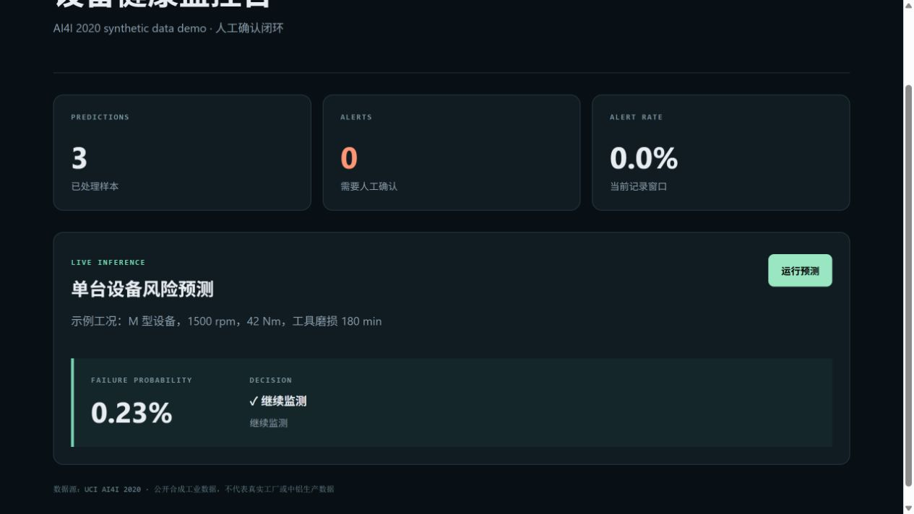
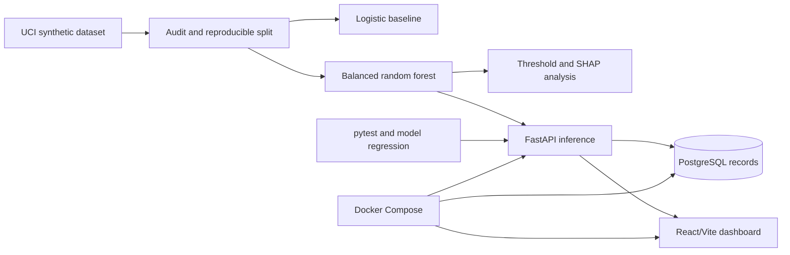

# Industrial Predictive Maintenance Platform

面向工业互联网与智能制造场景的端到端预测性维护作品集项目：从公开数据审计、故障风险建模和 SHAP 解释，一直到 FastAPI、PostgreSQL、React 监控看板、自动化测试与 Docker Compose 部署。

> 数据与安全边界：本项目使用 UCI AI4I 2020 Predictive Maintenance Dataset。它是公开的合成工业数据，不是中铝数据，也不代表任何真实工厂、生产线或设备。平台只展示风险告警和人工确认建议，不执行自动停机或其他高风险工业控制。



## 实际运行结果

固定 `random_state=42`，按 70%/15%/15% 分层切分 train/validation/test。阈值只在 validation 集选择，test 集只用于最终评估。

| 模型 | Test Recall | Test Precision | Test F1 | Test PR-AUC | Test ROC-AUC |
|---|---:|---:|---:|---:|---:|
| Logistic Regression | 0.3922 | 0.5263 | 0.4494 | 0.4307 | 0.9003 |
| Random Forest + class balancing | **0.7451** | **0.6032** | **0.6667** | **0.7476** | **0.9705** |

随机森林验证集最优 F1 阈值为 `0.335`。在 1,500 条测试样本上：TP=38、FN=13、FP=25、TN=1,424，漏报率为 25.49%。所有指标由脚本实际运行写入 `outputs/phase1/`，README 不作为指标真源。

## 数据审计与泄漏控制

- 10,000 行、14 列、0 缺失、0 重复 UID；故障率 3.39%。
- `UDI` 与 `Product ID` 是身份字段，不进入模型。
- `TWF/HDF/PWF/OSF/RNF` 是后验故障模式标签，若作为输入会造成目标泄漏，因此明确排除。
- 下载归档记录 SHA-256：`f601f14294bcf190f9d720676b7f0aea46a26cde9ab8ebc7b4f8174d9d26b252`。

数据来源：[UCI AI4I 2020 Predictive Maintenance Dataset](https://archive.ics.uci.edu/dataset/601/ai4i+2020+predictive+maintenance+dataset)，DOI `10.24432/C5HS5C`，CC BY 4.0。

## 系统架构



## 功能

- `GET /health`：服务、模型版本与阈值状态。
- `GET /metrics`：预测总量、告警总量、告警率。
- `POST /predict`：单条设备工况预测并落库。
- `POST /predict/batch`：最多 1,000 条批量预测，单事务落库。
- PostgreSQL 保存预测概率、阈值、告警状态、设备类型与时间。
- React 看板展示在线状态、预测量、告警量、告警率和单机预测结果。
- CORS 白名单、输入类型与范围校验；告警动作始终要求人工确认。

## 一键启动

```bash
docker compose up -d --build
```

默认地址：看板 `http://localhost:5173`，API 文档 `http://localhost:8080/docs`，PostgreSQL 暴露端口 `5433`。

端口被占用时可覆盖：

```powershell
$env:API_PORT="18080"
$env:FRONTEND_PORT="15173"
$env:POSTGRES_PORT="15433"
docker compose up -d --build
```

## 本地开发

```powershell
$py = "C:\Users\19551\.cache\codex-runtimes\codex-primary-runtime\dependencies\python\python.exe"
& $py -m pip install -r requirements.txt --target work/.python-packages
$env:PYTHONPATH = "work/.python-packages"
& $py scripts/run_phase1.py
& $py scripts/analyze_model.py
& $py scripts/explain_model.py
& $py -m pytest tests -q
```

前端：

```bash
cd frontend
pnpm install
pnpm run dev
pnpm run build
```

## 可复现实验证据

- `outputs/phase1/audit_and_metrics.json`：数据审计、切分和模型指标。
- `outputs/phase1/error_analysis_summary.json`：混淆矩阵统计与误差率。
- `outputs/phase1/error_analysis.csv`：逐条假阳性/假阴性样本。
- `outputs/phase1/threshold_metrics.csv`：181 个阈值下的 Recall/Precision/F1。
- `outputs/phase1/shap_feature_importance.csv`：1,000 条样本上的平均绝对 SHAP。
- `outputs/phase1/confusion_matrix.png` 与 `precision_recall_curve.png`：测试集图表。

## 已验证

- `pytest`：7 passed（API、CORS、输入边界、批量边界、模型质量门槛与泄漏字段）。
- Vite production build：成功。
- Docker Compose：PostgreSQL、FastAPI、React/Nginx 三服务成功构建并启动；数据库与 API health check 均通过。
- 容器端到端：调用 `/predict` 后 PostgreSQL `prediction_records` 新增记录。
- 浏览器端到端：看板显示 API ONLINE，预测后 metrics 自动更新并展示实际概率。

## 局限

- AI4I 是合成且静态的数据，不能证明跨工厂、跨设备或真实时序漂移下的效果。
- 当前模型预测“当前样本是否故障”，不等同于真实 Remaining Useful Life 估计。
- 阈值以验证集 F1 最大化选择；真实工厂应结合漏报成本、误报成本和安全规范重新标定。
- 当前持久化是演示级记录表；生产系统还需要认证授权、审计日志、迁移管理、可观测性和备份恢复。

## License

项目代码采用 MIT License；数据集遵循 UCI 页面标明的 CC BY 4.0。
