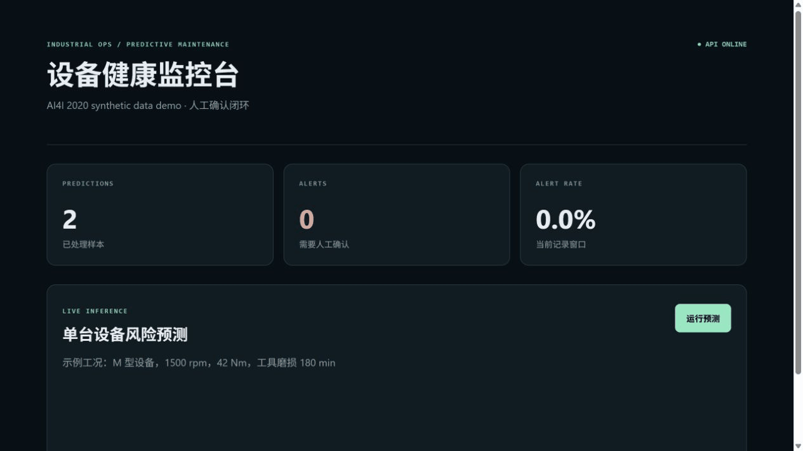
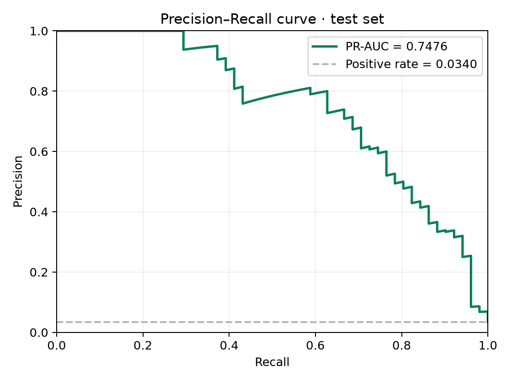
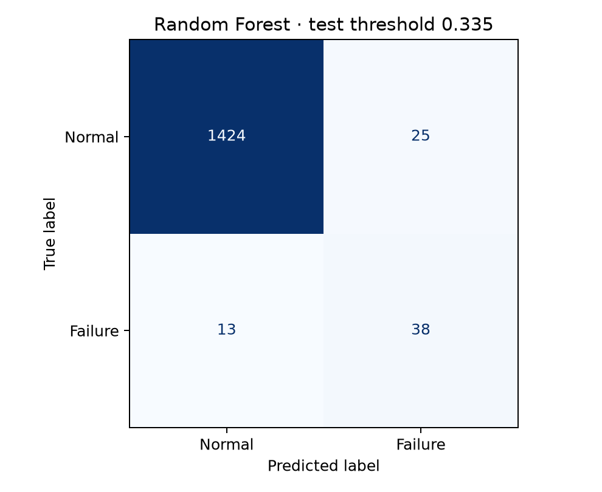
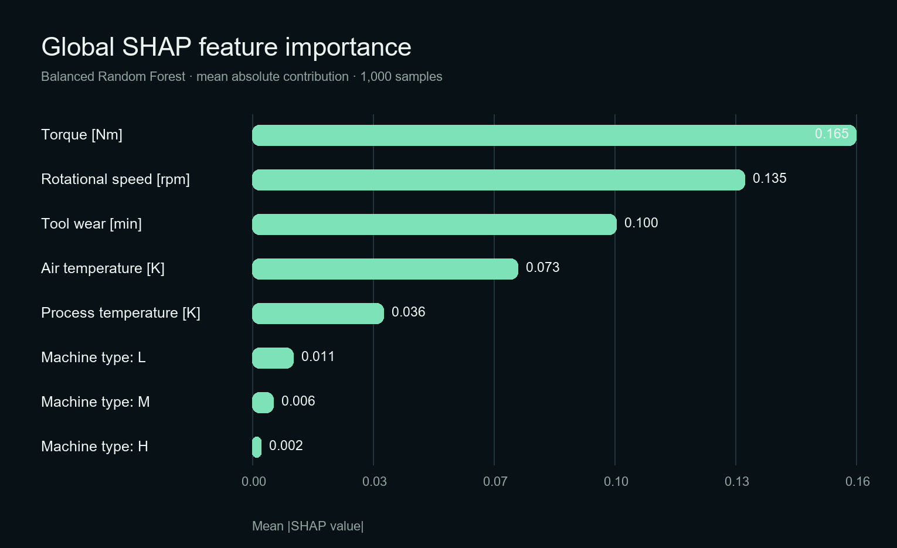
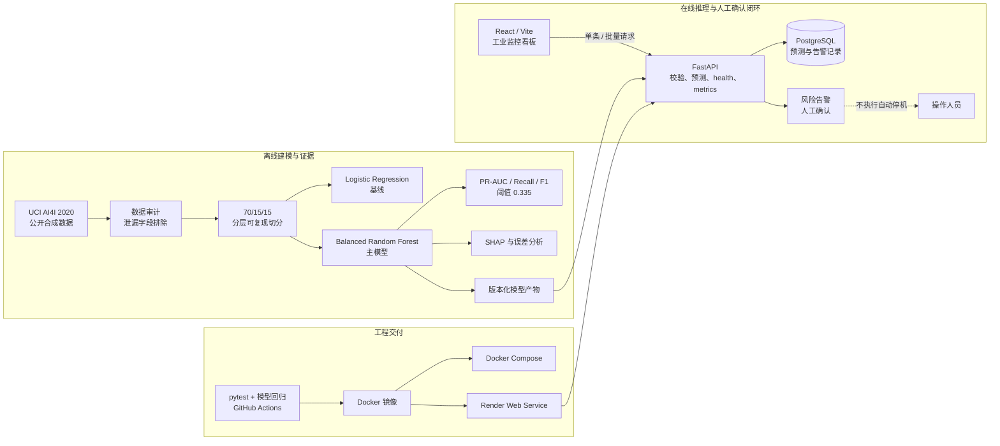

# Industrial Predictive Maintenance Platform

[](https://github.com/devispace/industrial-predictive-maintenance-platform/actions/workflows/ci.yml)
[](https://devispace-industrial-pm-platform.onrender.com)
[](LICENSE)
[](https://archive.ics.uci.edu/dataset/601/ai4i+2020+predictive+maintenance+dataset)

面向工业互联网与智能制造场景的端到端预测性维护作品集：覆盖数据审计、类别不平衡建模、阈值选择、SHAP 解释、FastAPI 推理、PostgreSQL 记录、React 工业看板、Docker Compose、自动化测试与 Render 公网部署。

> **数据与安全边界**：本项目使用 UCI AI4I 2020 公开合成工业数据，不是中铝数据，也不代表任何真实工厂、生产线或设备。平台只提供风险告警和人工确认建议，不执行自动停机或其他高风险工业控制。

**[打开在线演示](https://devispace-industrial-pm-platform.onrender.com)** · **[API 文档](https://devispace-industrial-pm-platform.onrender.com/docs)** · **[项目证据](outputs/PROJECT_EVIDENCE.md)** · **[简历表述](outputs/RESUME_PROJECT.md)** · **[面试讲稿](outputs/INTERVIEW_GUIDE.md)**

> Render 免费 Web Service 闲置后可能需要约 50 秒或更久冷启动；免费 PostgreSQL 仅保留 30 天。此部署用于招聘演示，不是生产环境。



## 实测结果

固定 `random_state=42`，按 70%/15%/15% 分层切分 train/validation/test；阈值仅在 validation 集选择，test 集只用于最终评估。

| 模型 | Test Recall | Test Precision | Test F1 | Test PR-AUC | Test ROC-AUC |
|---|---:|---:|---:|---:|---:|
| Logistic Regression | 0.3922 | 0.5263 | 0.4494 | 0.4307 | 0.9003 |
| Random Forest + class balancing | **0.7451** | **0.6032** | **0.6667** | **0.7476** | **0.9705** |

主模型验证集最优 F1 阈值为 `0.335`。在 1,500 条测试样本上：TP=38、FN=13、FP=25、TN=1,424，漏报率为 25.49%。所有指标均由脚本实际运行写入 `outputs/phase1/`，README 不是指标真源。

<table>
  <tr>
    <td></td>
    <td></td>
  </tr>
  <tr>
    <td align="center"><b>PR-AUC 0.7476</b></td>
    <td align="center"><b>TN 1,424 · FP 25 · FN 13 · TP 38</b></td>
  </tr>
</table>



SHAP 在 1,000 条样本上运行，平均绝对贡献最高的三个变量为扭矩、转速和工具磨损。SHAP 用于解释模型行为，不用于证明因果关系。

## 系统架构



## 数据审计与泄漏控制

- 10,000 行、14 列、0 缺失、0 重复 UDI；故障率 3.39%。
- `UDI` 与 `Product ID` 是身份字段，不进入模型。
- `TWF/HDF/PWF/OSF/RNF` 是后验故障模式标签，作为输入会泄漏目标，因此明确排除。
- 数据归档 SHA-256：`f601f14294bcf190f9d720676b7f0aea46a26cde9ab8ebc7b4f8174d9d26b252`。
- 来源：[UCI AI4I 2020 Predictive Maintenance Dataset](https://archive.ics.uci.edu/dataset/601/ai4i+2020+predictive+maintenance+dataset)，DOI `10.24432/C5HS5C`，CC BY 4.0。

## API 与看板

- `GET /health`：服务、模型版本与阈值状态。
- `GET /metrics`：预测总量、告警总量、告警率。
- `POST /predict`：单条设备工况预测并落库。
- `POST /predict/batch`：最多 1,000 条批量预测，单事务落库。
- PostgreSQL 保存预测概率、阈值、告警状态、设备类型与时间。
- React 看板展示在线状态、预测量、告警量、告警率和单机预测结果。
- CORS 白名单、输入类型与范围校验；任何告警动作始终要求人工确认。

## 60 秒快速启动

要求：Docker Desktop 与 Docker Compose。

```bash
git clone https://github.com/devispace/industrial-predictive-maintenance-platform.git
cd industrial-predictive-maintenance-platform
docker compose up -d --build
```

启动后访问：

- 看板：`http://localhost:5173`
- API 文档：`http://localhost:8080/docs`
- PostgreSQL：`localhost:5433`

端口被占用时可覆盖：

```powershell
$env:API_PORT="18080"
$env:FRONTEND_PORT="15173"
$env:POSTGRES_PORT="15433"
docker compose up -d --build
```

关闭服务但保留数据库卷：

```bash
docker compose stop
```

## 复现实验与测试

```bash
python -m venv .venv
# Windows: .venv\Scripts\activate
# Linux/macOS: source .venv/bin/activate
python -m pip install -r requirements.txt
python scripts/run_phase1.py
python scripts/analyze_model.py
python scripts/explain_model.py
python scripts/generate_readme_assets.py
pytest tests -q
```

前端：

```bash
cd frontend
pnpm install --frozen-lockfile
pnpm run build
```

证据文件：

- `outputs/phase1/audit_and_metrics.json`：数据审计、切分和模型指标。
- `outputs/phase1/error_analysis_summary.json`：混淆矩阵与错误率。
- `outputs/phase1/error_analysis.csv`：逐条假阳性/假阴性样本。
- `outputs/phase1/threshold_metrics.csv`：181 个阈值下的 Recall/Precision/F1。
- `outputs/phase1/shap_feature_importance.csv`：1,000 条样本上的平均绝对 SHAP。

## 部署与质量状态

- GitHub Actions：训练、分析、SHAP、8 项 pytest、Vite build 与 Compose 配置验证。
- Docker Compose：PostgreSQL、FastAPI、React/Nginx 三服务已完成端到端验证。
- Render：同源 React/FastAPI Docker 服务与 PostgreSQL 已公开部署。
- 公网实测：API ONLINE；预测返回 0.23%，记录计数由 0 增至 1。
- 安全检查：Python 与前端生产依赖均未发现已知漏洞；详情见 [`outputs/SECURITY_AUDIT.md`](outputs/SECURITY_AUDIT.md)。

[](https://render.com/deploy?repo=https://github.com/devispace/industrial-predictive-maintenance-platform)

## 局限与生产差距

- AI4I 是合成且静态的数据，不能证明跨工厂、跨设备或真实时序漂移下的效果。
- 当前模型预测“当前样本是否故障”，不等同于 Remaining Useful Life 估计。
- 阈值以验证集 F1 最大化选择；真实工厂必须结合漏报成本、误报成本和安全规范重新标定。
- API 当前无认证，持久化为演示级记录表；生产系统还需要 IAM、审计日志、速率限制、数据库迁移、可观测性、备份恢复和正式安全评审。

## License

项目代码采用 [MIT License](LICENSE)；数据集遵循 UCI 页面标明的 [CC BY 4.0](https://creativecommons.org/licenses/by/4.0/)。
